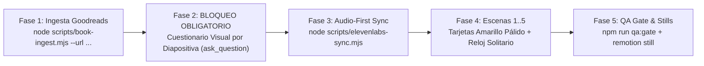

# AutoVideo Book Studio (`@en1minuto.es`) — Motor Programático de Shorts de Resúmenes de Libros (60–65s · Remotion + Goodreads + ElevenLabs)

Estudio automatizado de generación de vídeos verticales de resúmenes de libros (**9:16 · 1080×1920 @ 30 fps · 60–65 segundos**) construido sobre **Remotion 4**, **Ingesta Directa desde Goodreads (`scripts/book-ingest.mjs`)**, **Cuestionario Interactivo de Gráficos por Diapositiva (`ask_question`)**, **ElevenLabs Audio-First Sync** y el sistema de componentes cinéticos en **Amarillo Pálido (`#FEF9C3`)**.

---

## 1. Workflow Principal de Creación a partir de Título + Enlace de Goodreads



1. **Fase 1 — Ingesta Directa desde Goodreads ([`scripts/book-ingest.mjs`](scripts/book-ingest.mjs))**:
   ```bash
   node scripts/book-ingest.mjs --query "El poder de los hábitos" --url "https://www.goodreads.com/book/show/12609433-the-power-of-habit"
   ```
   - Extrae de **Goodreads** (JSON-LD), **Google Books** y **Open Library** el autor, puntuación real, número de votos, páginas y descarga la portada oficial en `public/assets/books/<slug>-cover.jpg`.
   - Genera [`src/data/book-dossier.json`](src/data/book-dossier.json) sin desperdiciar tokens.

2. **Fase 2 — Cuestionario Interactivo de Gráficos por Diapositiva (`ask_question` — OBLIGATORIO)**:
   - **Antes** de generar el audio en ElevenLabs o programar `Scene1.tsx`–`Scene5.tsx`, el agente lanza obligatoriamente la herramienta `ask_question` para decidir con el usuario qué gráfico cinético integrar en cada una de las 5 diapositivas:
     - **Diapositiva 1**: `Portada 2.5D + LiveCounter + ComparisonBattle (Mito vs Realidad)`
     - **Diapositiva 2**: `VectorLoopCircuit (Circuito de 4 fases con sombreado activo sincronizado a la voz)` o `ExponentialGrowthChart`
     - **Diapositiva 3**: `KineticCard con Cita Subrayada + Diagrama de Sustitución (Rutina Vieja tachada vs Nueva Rutina)`
     - **Diapositiva 4**: `Cascada de 3 Casos Reales en Tarjetas Amarillo Pálido + Efecto Dominó en Cadena`
     - **Diapositiva 5**: `KineticCard Manifiesto + Ficha Goodreads + CtaEndCard con Cronómetro Hero`

3. **Fase 3 — Sincronización Audio-First ([`scripts/elevenlabs-sync.mjs`](scripts/elevenlabs-sync.mjs))**:
   - Sintetiza las 5 pistas MP3 con la voz canónica de Leo (`RwzBDEn5f6FIgpAjH9YN` en ElevenLabs) y calcula los timestamps palabra por palabra en [`public/audio/info.json`](public/audio/info.json).

4. **Fase 4 — Identidad Visual Consolidada `@en1minuto.es`**:
   - **Sin Banner Inferior**: Se eliminó el banner inferior completo; en `bottom: 48px` corre **únicamente el reloj `<OneMinuteStopwatch />`** con una animación ligera continua de latido y balanceo (`gentlePulse` + `gentleSwayDeg`).
   - **Tarjetas en Amarillo Pálido (`#FEF9C3` / `#FFFBEB`)**: Todas las tarjetas destacan sobre el papel marfil `#F8F7F4` con relleno amarillo pálido cálido y bordes nítidos (`2px solid #141413` o `#D94E34`).
   - **Títulos de Tarjetas Limpios**: Títulos integrados en la cabecera interna de cada tarjeta en `Plus Jakarta Sans` 800 sin etiquetas flotantes superpuestas.
   - **Subtítulos `Nunito` 800**: Fuente redondeada de alta legibilidad sincronizada palabra por palabra sin vibraciones.

---

## 2. Comandos de Validación y Renderizado

```bash
# 1. Verificar tipos TypeScript y las 16 reglas del Critic Gate
npm.cmd run typecheck
npm.cmd run qa:gate

# 2. Renderizar fotogramas de verificación rápida (Stills)
npx.cmd remotion still src/index.ts MainVideo out/preview-s1.png --frame=360

# 3. Abrir Remotion Studio o renderizar MP4 final
npm.cmd run dev
npm.cmd run build
```
