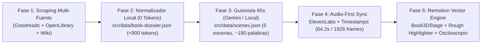

# AutoVideo Book Studio — Motor Programático de Shorts de Resúmenes de Libros (60–65s · Remotion + Gemini + ElevenLabs)

Estudio automatizado de generación de vídeos verticales de resúmenes de libros (**9:16 · 1080×1920 @ 30 fps · 60–65 segundos**) construido sobre **Remotion 4**, **Scraping Multi-Fuente con Compresión Determinista Zero-Token-Waste**, **Guionista Google Gemini (`gemini-2.5-flash`)**, **ElevenLabs Audio-First Sync** y el sistema de primitivas vectoriales **`BookBlueprints` + `@resultaaquee`**.

---

## 1. Arquitectura del Pipeline (Ahorro Extremo de Tokens ~90%)



1. **Fase 1 & 2 — Ingesta Multi-Fuente y Normalizador «Zero-Token-Waste» ([`scripts/book-ingest.mjs`](src/data/book-dossier.json))**:
   - Extrae de **Goodreads** (JSON-LD + `/quotes`), **Open Library**, **Google Books** y **Wikipedia** la puntuación real, número de reseñas, páginas, portada en alta resolución, citas más votadas y leyes prácticas.
   - Limpia HTML, anuncios y duplicados en local sin consumir un solo token de LLM, generando [`src/data/book-dossier.json`](src/data/book-dossier.json) (**~890 tokens netos**, ahorrando ~90% de tokens frente al HTML bruto) y descargando la portada en `public/assets/books/<slug>-cover.jpg`.
2. **Fase 3 — Guionista de Retención en 5 Escenas ([`scripts/book-scriptwriter.mjs`](scripts/book-scriptwriter.mjs))**:
   - Conecta con **Google Gemini Free Tier (`gemini-2.5-flash`)** o utiliza su compilador determinista local de 0 tokens si no se define API key.
   - Estructura el resumen en **5 escenas (~180 palabras + pausas prosódicas `[PAUSA 0.4s]`)** calibradas para durar entre **62 y 65 segundos**.
   - **Dicción TTS vs Telemetría Visual**: Todos los números en `text` se escriben en letra (`"uno por ciento"`, `"treinta y siete coma setenta y ocho veces"`) mientras los gráficos vectoriales muestran las cifras técnicas (`"+1%"`, `"37.78x"`, `"★ 4.38"`).
3. **Fase 4 — Sincronización Audio-First ([`scripts/elevenlabs-sync.mjs`](scripts/elevenlabs-sync.mjs))**:
   - Sintetiza las 5 pistas MP3 con la voz de Leo (`es-ES-AlvaroNeural` vía edge-tts o `RwzBDEn5f6FIgpAjH9YN` en ElevenLabs) y calcula las marcas de tiempo palabra por palabra en [`public/audio/info.json`](public/audio/info.json).
4. **Fase 5 — Edición Vectorial Animada ([`src/components/blueprints/BookBlueprints.tsx`](src/components/blueprints/BookBlueprints.tsx))**:
   - **`<Book3DStage />`**: Aparejo isométrico 2.5D del libro con portada real, lomo volumétrico, bloque de páginas proporcional, levitación Perlin (`noise2D`) y anillo CAD con morphing `flubber`.
   - **`<EditorialExcerptHighlighter />`**: Hoja de papel técnico cálido (`#F8F7F4`) con trazos de rotulador físico `roughjs` situados **detrás del texto serif y encima del papel**, revelados de izquierda a derecha en sincronía con la voz.
   - **`<HabitLoopDiagram />` & `<ActionableLawsDrawer />`**: Diagrama neuronal de 4 fases y cajón escalonado de las leyes prácticas del libro con barras de eficacia y `VectorSelectionBox`.
   - **`<BookVerdictScorecard />`**: Ficha de síntesis final con cita de identidad y telemetría verificada de Goodreads.

---

## 2. Las 5 Escenas del Formato Resumen de Libro (64.2s · 1926 Fotogramas)

| Escena | Ventana | Blueprint / Modo | Contenido Visual y Narrativo ( Caso Demo: *«Hábitos Atómicos»* ) |
| :--- | :---: | :--- | :--- |
| **Escena 1** | `00s – 14s` | `DARK_CAD_XRAY` | **La Trampa de las Metas**: `Book3DStage` 2.5D + `ConceptHypothesisScoreboard` (`[METAS̸]` vs `[SISTEMAS]`) + Cotas quebradas. |
| **Escena 2** | `14s – 26s` | `CHRONO_OSCILLOSCOPE` | **La Matemática del 1%**: Fórmula `1.01^365 = 37.78x` + Dianas `TargetReticle` + Osciloscopio de doble curva en vivo (`LiveTelemetryGraph`). |
| **Escena 3** | `26s – 39s` | `EDITORIAL_PAPER` | **Pasaje Central y Bucle Neuronal**: `EditorialExcerptHighlighter` con subrayado físico `roughjs` + `HabitLoopDiagram` (`Señal -> Anhelo -> Respuesta -> Recompensa`). |
| **Escena 4** | `39s – 52s` | `BLUEPRINT_BLUE` | **Las 4 Leyes Accionables**: `ActionableLawsDrawer` desplegando las 4 Leyes del Cambio y la Regla de los 2 Minutos. |
| **Escena 5** | `52s – 64.2s` | `TOPOLOGY_WIREFRAME` | **Votos de Identidad y Veredicto**: `Book3DStage` + `BookVerdictScorecard` (`★ 4.38 · 1.94M reseñas · 4.2h lectura`). |

---

## 3. Uso Rápido

### 1. Ejecutar el Pipeline Completo para un Libro
```bash
# 1. Scraping multi-fuente (Goodreads + OpenLibrary + Wiki) y compresión a <900 tokens
npm run book:ingest -- --query "Hábitos Atómicos James Clear"

# 2. Generación del guion de 5 escenas (Gemini 2.5 Flash o compilador local 0 tokens)
npm run book:script

# 3. Síntesis de voz y alineación palabra por palabra (60-65s)
npm run sync:audio
```
*(O ejecuta todo de una vez con `npm run book:pipeline`).*

### 2. Validar Calidad y Critic Gate (16 puntos)
```bash
npm run typecheck
npm run qa:gate
```

### 3. Previsualizar en Vivo o Renderizar MP4
```bash
# Abrir Remotion Studio interactivo (http://localhost:3000)
npm run dev

# Renderizar el Short completo en MP4 (1080x1920 @ 30fps)
npm run build
```
